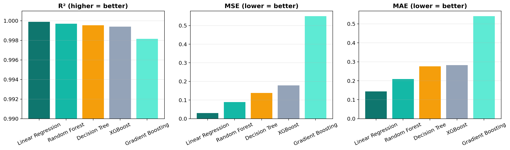
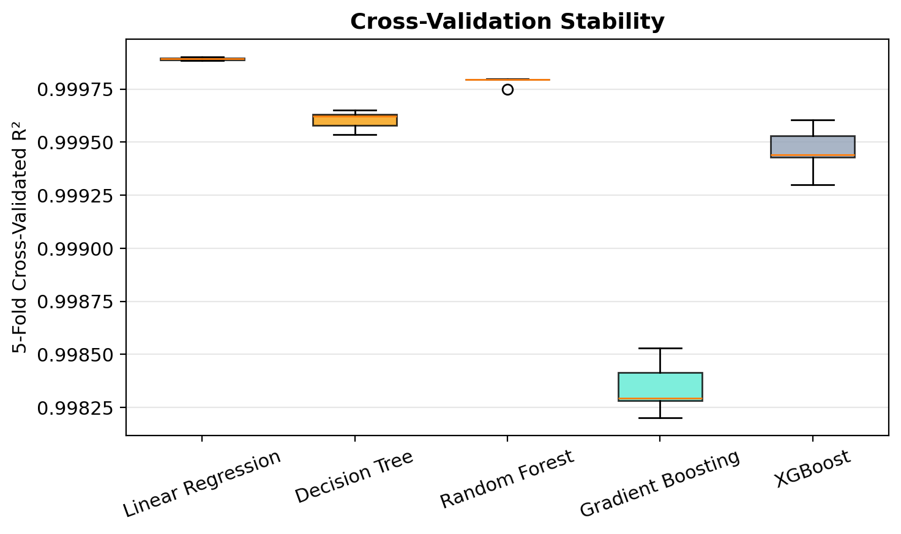

# Machine Learning Assisted Stress Prediction of Gyroid TPMS Structures

Predicting the compressive stress response of gyroid triply periodic minimal surface
(TPMS) lattices from finite element simulation data, so that a candidate geometry can
be evaluated without running a new Abaqus job for every design.



## Problem

Gyroid lattices are used where stiffness matters more than mass. Their response depends
on several geometric parameters at once (unit cell length, wall thickness, fill percent,
specimen height, cross-sectional area), and each candidate geometry normally costs a
full FEA solve to evaluate. That makes design exploration slow.

The question this project asks: can a model trained on a small set of simulated
geometries predict the stress response of the lattice accurately enough to be useful
for screening?

## Dataset

Abaqus compression simulations of **5 gyroid geometries**, exported as time-step
records — **2525 rows, 13 columns**.

| Geometry | Cell length (mm) | Thickness (mm) | Fill (%) | Height (mm) |
|---|---|---|---|---|
| 1 | 10 | 1 | 29.1 | 20 |
| 2 | 15 | 2 | 40.4 | 30 |
| 3 | 20 | 4 | 58.8 | 40 |
| 4 | 25 | 4 | 48.0 | 50 |
| 5 | 30 | 7 | 67.1 | 60 |

Recorded per time step: internal and kinetic energy, reaction force, displacement,
engineering stress and strain, and the geometric parameters of the specimen.

**Target:** engineering stress (MPa).

## Method

1. Load and clean the Abaqus export; engineer a categorical `Geometry_ID` feature
2. Explore the data (stress-strain curves, correlation heatmap)
3. Build preprocessing pipelines: one-hot encoding, standard scaling, polynomial features
4. Train and compare **five regressors** under identical splits and cross-validation
5. Interpret the winner (feature importance, residual analysis)
6. Validate rather than just fit:
   - a bias-variance complexity curve for the decision tree
   - a `GridSearchCV` hyperparameter search for the random forest

Train/test split: 1750 / 750 rows, with 5-fold cross-validation.

## Results

| Model | Test R² | MSE | MAE | CV mean | CV std |
|---|---|---|---|---|---|
| **Linear Regression** | **0.999897** | 0.0307 | **0.1441** | 0.999893 | 0.000006 |
| Random Forest | 0.999699 | 0.0897 | 0.2088 | 0.999786 | 0.000019 |
| Decision Tree | 0.999536 | 0.1382 | 0.2759 | 0.999604 | 0.000041 |
| XGBoost | 0.999400 | 0.1787 | 0.2822 | 0.999461 | 0.000103 |
| Gradient Boosting | 0.998150 | 0.5507 | 0.5411 | 0.998345 | 0.000115 |

Residual standard deviation for the best model: **0.175 MPa**, maximum absolute
residual **0.549 MPa**.

### The interesting result

**A properly feature-engineered linear model beats every tree ensemble here.** That is
worth stating plainly because it is the opposite of the usual expectation.

The reason is physical: the simulations sit in the elastic regime, where stress is
essentially linear in strain, and the geometric parameters scale that relationship.
Once polynomial and interaction terms are supplied, a linear model matches the physics
directly, while tree ensembles have to approximate a smooth linear surface with piecewise
constant splits — which costs them accuracy.

To check this was not simply an untuned-baseline artefact, the random forest was given a
`GridSearchCV` search over 18 combinations with 3-fold CV:

| Model | Test R² | Test MAE |
|---|---|---|
| Linear Regression (untouched) | 0.99990 | 0.1441 |
| Random Forest (default) | 0.99970 | 0.2088 |
| Random Forest (tuned) | 0.99971 | 0.2029 |

Tuning moved the random forest by a negligible amount and it still did not overtake the
linear baseline. The conclusion holds.

### Bias-variance check



Sweeping decision-tree depth: at depths 1–5 train and test scores are both low and close
together (underfitting). Test R² plateaus around depth 10–12 while train R² keeps climbing
toward 1.0 — at depth 20, train R² is 0.99998 against test 0.99961. That widening gap is
overfitting beginning, and it is why depth 10 was used.

## Figures

| File | Shows |
|---|---|
| [`02_eda_correlation_heatmap.png`](figures/02_eda_correlation_heatmap.png) | feature correlations |
| [`04_cv_boxplot.png`](figures/04_cv_boxplot.png) | cross-validation score distributions |
| [`05_feature_importance.png`](figures/05_feature_importance.png) | random forest feature importances |
| [`06_actual_vs_predicted.png`](figures/06_actual_vs_predicted.png) | parity plot and residuals for the best model |
| [`07_bias_variance_complexity_curve.png`](figures/07_bias_variance_complexity_curve.png) | tree depth vs train/test score |
| [`08_tuning_comparison.png`](figures/08_tuning_comparison.png) | effect of hyperparameter tuning |

The script also writes `01_eda_stress_strain.png` (stress-strain curves for all five
geometries) and `03_model_comparison.png` (test metrics across the five models) when it
is run.

## Repository layout

```
gyroid_ml_pipeline.py    complete pipeline: load -> EDA -> train -> diagnose
data/                    place gyroid_fea_results.xlsx here (not yet in the repo)
figures/                 generated plots
docs/                    project presentation
requirements.txt
```

## Running it

The Abaqus export (`gyroid_fea_results.xlsx`) is not included in this repository yet.
Put it at `data/gyroid_fea_results.xlsx`, then:

```bash
pip install -r requirements.txt
python gyroid_ml_pipeline.py
```

Every metric in this README is recomputed from that file — none is hard-coded — and
every figure is regenerated on each run.

## Context

Course project for **MSE643 — Artificial Intelligence and Machine Learning in Materials
Engineering** (AI/ML track), Department of Materials Science and Engineering,
IIT Kanpur.
